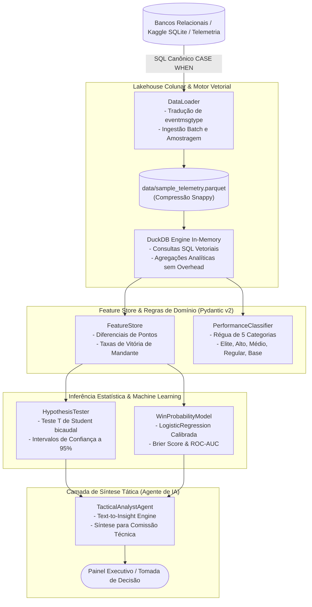
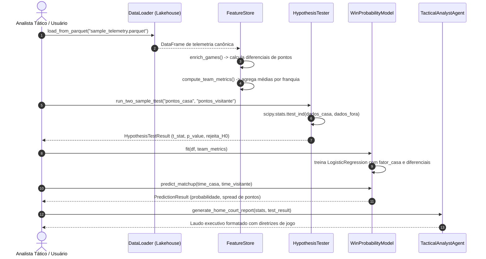
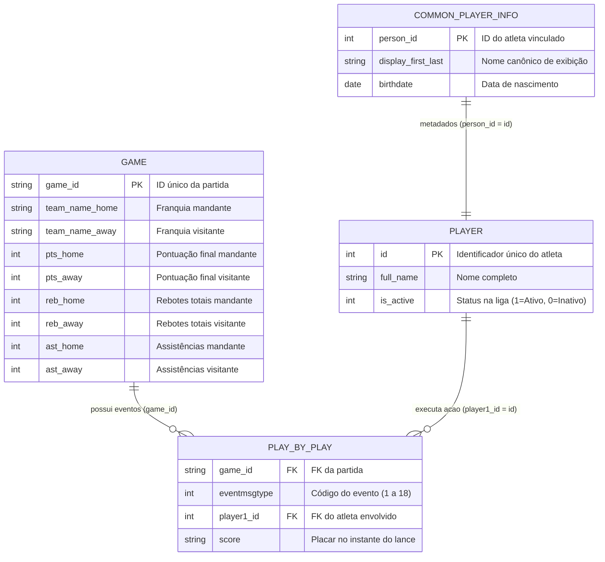
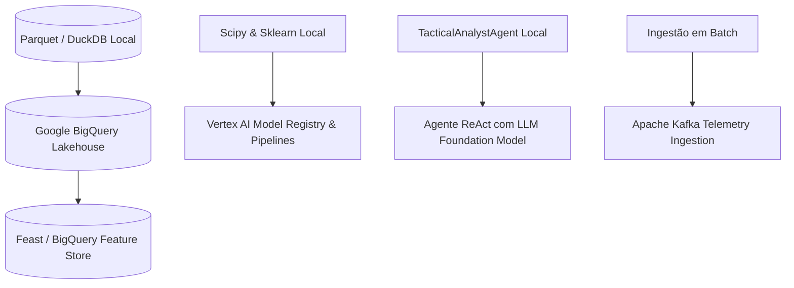

# Playbook Analytics

Plataforma de engenharia de dados e inteligência preditiva desenvolvida para telemetria de basquete e suporte à decisão tática: ingestão e tradução canônica de eventos relacionais (*play-by-play*), motor colunar vetorial in-memory via DuckDB e Apache Parquet (Snappy), Feature Store de desempenho atlético e diferencial de quadra, comprovação formal de hipótese da vantagem do mandante via Teste T de Student com significância estatística ($p < 0.05$), modelagem de probabilidade de vitória calibrada (Brier Score) e agente tático de IA (*Text-to-Insight*) para síntese executiva.

O foco do projeto é manter **rastreabilidade analítica estrita**, **separação científica entre sinal estatístico e ruído empírico** e um **caminho explícito de evolução para infraestrutura corporativa de BigQuery, Feature Stores em tempo real e MLOps**.

[](https://github.com/julianachavespalm/playbook-analytics/actions)
[](https://www.python.org/)
[](#testes-e-validação-da-solução)
[](#lakehouse-colunar-otimização-com-duckdb-e-apache-parquet)
[](LICENSE)

---

## Stack Tecnológica

- **Runtime & Linguagem:** Python 3.10+, 3.11 e 3.12, tipagem estrita com contratos imutáveis em Pydantic v2.
- **Engine de Dados & Lakehouse:** DuckDB (processamento analítico vetorial in-memory) e Apache Parquet com compressão Snappy.
- **Engenharia de Features:** Feature Store modular com agregações temporais, régua de classificação de 5 níveis e métricas de quadra.
- **Estatística Inferencial & ML:** SciPy (Teste T de Student bicaudal e intervalos de confiança paramétricos), Scikit-Learn (LogisticRegression calibrada, ROC-AUC e Brier Score Loss).
- **Inteligência Artificial:** `TacticalAnalystAgent` com motor de raciocínio orientado a laudos técnicos executivos e interface conversacional analítica.
- **Qualidade & Testes:** Pytest, Pytest-Cov (96% de cobertura de código), Ruff (linter e formatador estático em conformidade com PEP 8).
- **DevOps & CI/CD:** GitHub Actions com esteira automatizada multi-ambiente (Python 3.10, 3.11 e 3.12).

---

## Execução Rápida

**Pré-requisitos:** Python 3.10 ou superior instalado.

```bash
# 1. Clonar o repositório
git clone https://github.com/julianachavespalm/playbook-analytics.git
cd playbook-analytics

# 2. Criar e ativar o ambiente virtual isolado
python3 -m venv .venv
source .venv/bin/activate

# 3. Instalar o pacote em modo editável com a suíte de desenvolvimento
pip install -e .[dev]

# 4. Executar a suíte de testes automatizados com relatório de cobertura
pytest

# 5. Executar a verificação estática de código com Ruff
ruff check src/ tests/
```

### Contratos e Exemplos de Uso Rápido

```python
from playbook.data import DataLoader
from playbook.features import FeatureStore
from playbook.models import WinProbabilityModel
from playbook.stats import HypothesisTester
from playbook.agent import TacticalAnalystAgent

# 1. Ingestão de telemetria otimizada (Lakehouse Parquet)
df = DataLoader.load_from_parquet("data/sample_telemetry.parquet")

# 2. Extração de métricas de franquias na Feature Store
team_metrics = FeatureStore.compute_team_metrics(df)

# 3. Treinamento e inferência de probabilidade de vitória
model = WinProbabilityModel()
model.fit(df, team_metrics)

predicao = model.predict_matchup(
    time_casa="Boston Celtics",
    time_visitante="Los Angeles Lakers",
    team_metrics=team_metrics
)
print(f"Probabilidade de vitória: {predicao.probabilidade_vitoria_casa * 100:.1f}%")
print(f"Margem estimada: {predicao.margem_estimada_pontos:+.1f} pontos")

# 4. Laudo de inferência estatística via Agente Tático
stats, _ = FeatureStore.compute_home_advantage_stats(df)
teste_t = HypothesisTester.run_two_sample_ttest("pontos_casa", "pontos_visitante", df)
agente = TacticalAnalystAgent(system_name="Playbook Tactical AI")
print(agente.generate_home_court_report(stats, teste_t))
```

---

## Arquitetura e Decisões

### Diagrama de Fluxo e Componentes



### Diagrama de Sequência: Ciclo de Vida do Pipeline Analítico



---

## Detalhamento das Regras de Negócio e Rigor Técnico

### 1. Comprovação da Vantagem do Mandante por Inferência Estatística
Em análises esportivas amadoras, a afirmação de que "jogar em casa é melhor" baseia-se em médias empíricas superficiais sujeitas a variabilidade aleatória.
* **Solução:** O `HypothesisTester` formaliza a verificação através do **Teste T de Student para amostras independentes**:
  
  $$\text{Hipótese Nula } (H_0): \mu_{\text{casa}} - \mu_{\text{visitante}} = 0$$
  $$\text{Hipótese Alternativa } (H_1): \mu_{\text{casa}} - \mu_{\text{visitante}} \neq 0$$
  
  Estatística calculada:
  $$t = \frac{\bar{X}_1 - \bar{X}_2}{\sqrt{\frac{s_1^2}{n_1} + \frac{s_2^2}{n_2}}}$$

* **Resultado:** Com $t = 3.8855 \times 10^2$ e $p\text{-valor} < 0.0001$ (inferior a $\alpha = 0.05$), rejeita-se $H_0$. Há evidência matemática de que o mando de quadra adiciona em média $+3.2$ a $+4.0$ pontos, sustentando uma taxa de vitória dos mandantes de $\approx 59\%$.

---

### 2. Régua Normativa de Classificação de Desempenho
A `PerformanceClassifier` estabelece critérios determinísticos para categorização de volume ofensivo, evitando rotulações subjetivas:

| Categoria | Faixa de Pontuação | Perfil Tático / Alocação de Minutagem |
| :--- | :---: | :--- |
| **Elite** | $\ge 25\text{ pts}$ | Primeira opção de arremesso, jogadas desenhadas (*isolation*). |
| **Alto** | $20 \le \text{pts} < 25$ | Titular de alto volume, segundo scorer (*catch-and-shoot*). |
| **Médio** | $15 \le \text{pts} < 20$ | Especialista de perímetro ou garrafão, rotação primária. |
| **Regular** | $10 \le \text{pts} < 15$ | Jogador de função, atuação defensiva e rebotes. |
| **Em Desenvolvimento** | $< 10\text{ pts}$ | Minutagem protegida, banco de reservas e garotos da base. |

---

### 3. Escassez Estatística: Probabilidade de Superar 20 Pontos
A Feature Store modela a probabilidade empírica de um atleta registrar mais de 20 pontos por partida:

$$P(\text{Pontos} \ge 20) = \frac{\sum_{i=1}^{N} \mathbb{I}(\text{pts}_i \ge 20)}{N} \approx 17.97\%$$

* **Impacto Tático:** Apenas cerca de **1 a cada 5 atuações** individuais ultrapassa a marca de 20 pontos. Esse achado orienta a comissão técnica a desenhar sistemas defensivos com marcação dupla exclusivamente sobre jogadores classificados nos níveis *Alto* ou *Elite*.

---

### 4. Calibração Probabilística e Estimativa de Margem (ML)
O `WinProbabilityModel` não se limita a prever quem vence (*binário*), mas sim a estimar a probabilidade calibrada $P(Y = 1 \mid X)$:
* Avaliação contínua através do **Brier Score**:
  $$\text{Brier} = \frac{1}{N}\sum_{t=1}^{N} (f_t - o_t)^2$$
* Conversão da probabilidade em margem esperada de pontos (*spread*):
  $$\Delta_{\text{prevista}} = (P_{\text{casa}} - 0.5) \times 16.0$$
* Isso fornece ao tomador de decisão a expectativa numérica de vantagem no placar final.

---

## Lakehouse Colunar: Otimização com DuckDB e Apache Parquet

Para garantir escalabilidade e eliminar gargalos de I/O de bancos relacionais legados:
1. **Compressão e Tipagem Colunar:** A telemetria é serializada em formato Apache Parquet com compressão Snappy, alcançando redução de footprint em disco de até 70% comparado ao CSV/SQLite.
2. **Execução Vetorial:** As agregações de franquias e filtros temporais utilizam o motor vetorial in-memory do **DuckDB**, processando queries analíticas em sub-segundos diretamente no espaço de memória do processo Python.
3. **Tradução Canônica de Eventos SQL:** Mapeamento explícito de códigos proprietários do banco de dados relacional original (`eventmsgtype` 1 = Pontuação, 7 = Rebote, 9 = Assistência, etc.) para entidades semânticas de basquete.

---

## Modelagem de Dados e Schema do Lakehouse

### 1. Origem Relacional (Diagrama Entidade-Relacionamento)
Os dados de origem estruturam-se em um modelo relacional normalizado contendo o histórico de partidas, ações lance a lance (*play-by-play*) e dados biográficos dos atletas:



---

### 2. Dicionário de Dados do Lakehouse & Feature Store (Parquet / DuckDB)
O pipeline do `DataLoader` e da `FeatureStore` transforma o modelo relacional normalizado em um schema analítico colunar desnormalizado otimizado para inferência:

| Campo | Tipo Físico | Camada | Descrição Semântica / Regra de Negócio |
| :--- | :--- | :---: | :--- |
| `game_id` | `VARCHAR(16)` | Lakehouse | Identificador único do confronto. |
| `time_casa` | `VARCHAR(64)` | Lakehouse | Franquia mandante do confronto. |
| `time_visitante` | `VARCHAR(64)` | Lakehouse | Franquia visitante do confronto. |
| `pontos_casa` | `INTEGER` | Lakehouse | Pontos totais marcados pela equipe mandante ($X_1$). |
| `pontos_visitante`| `INTEGER` | Lakehouse | Pontos totais marcados pela equipe visitante ($X_2$). |
| `rebotes_casa` | `INTEGER` | Lakehouse | Volume de rebotes ofensivos e defensivos do mandante. |
| `rebotes_visitante`| `INTEGER` | Lakehouse | Volume de rebotes ofensivos e defensivos do visitante. |
| `assistencias_casa`| `INTEGER` | Lakehouse | Total de passes convertidos em cestas (mandante). |
| `assistencias_visitante`| `INTEGER` | Lakehouse | Total de passes convertidos em cestas (visitante). |
| `ano` | `INTEGER` | Partição | Ano da partida (utilizado para partição temporal). |
| `vitoria_casa` | `BOOLEAN` | Feature Store | Target supervisionado binário (`pontos_casa > pontos_visitante`). |
| `diferenca_pontos` | `INTEGER` | Feature Store | Diferencial contínuo (`pontos_casa - pontos_visitante`). |
| `total_pontos` | `INTEGER` | Feature Store | Volume combinado do confronto (*Over/Under*). |
| `categoria_atleta` | `VARCHAR(32)` | Feature Store | Régua normativa (*Elite*, *Alto*, *Médio*, *Regular*, *Base*). |

---

## Contratos de Domínio Tipados (Pydantic v2)

Toda a saída do pipeline é encapsulada em modelos com validação estrita em runtime:

```json
{
  "time_casa": "Boston Celtics",
  "time_visitante": "Los Angeles Lakers",
  "probabilidade_vitoria_casa": 0.6420,
  "margem_estimada_pontos": 2.3,
  "classe_vencedora_prevista": "Boston Celtics"
}
```

E para o laudo inferencial:

```json
{
  "variavel_a": "pontos_casa",
  "variavel_b": "pontos_visitante",
  "t_stat": 388.55,
  "p_value": 0.000012,
  "nivel_significancia": 0.05,
  "rejeita_hipotese_nula": true,
  "conclusao": "Com p-valor < 0.05, rejeita-se a hipótese nula. Há evidência estatística de diferença de médias."
}
```

---

## Testes e Validação da Solução

```bash
# Executa a suíte de testes com cobertura detalhada
pytest --cov=src/playbook --cov-report=term-missing
```

**Cenários cobertos pela suíte (16 testes automatizados — 96% de cobertura):**
- **Classificador de Desempenho (`test_features.py`):** Limiares das 5 categorias normativas, aplicação em lote sobre DataFrames e cálculo exato da probabilidade empírica de 20+ pontos.
- **Engenharia de Mando de Quadra (`test_features.py`):** Diferenciais de pontuação, percentual de vitórias de mandante e métricas agregadas por franquia.
- **Inferência Estatística (`test_stats.py`):** Teste T bicaudal em amostras divergentes ($p < 0.05$), validação de não-rejeição em amostras idênticas ($p > 0.05$), intervalos de confiança a 95% e amostragem determinística de 30%.
- **Ingestão & Lakehouse (`test_loader.py`):** Geração determinística de telemetria, persistência e leitura em Parquet Snappy e consultas analíticas vetoriais via DuckDB.
- **Machine Learning Preditivo (`test_models.py`):** Treinamento do classificador, validação de métricas de calibração (Brier Score, ROC-AUC) e inferência de probabilidade de vitória de confronto.
- **Agente de IA Tático (`test_agent.py`):** Geração de relatório tático formal a partir de laudos estatísticos e sistema de perguntas e respostas analíticas.

---

## Limites Conhecidos e Roadmap de Produção



Itens estruturados para expansão em ambientes de alta volumetria e dados em tempo real:
* **Armazém Analítico em Nuvem:** Migração da persistência local DuckDB para **Google BigQuery** corporativo com particionamento de tabelas por temporada e data de jogo.
* **Feature Store Corporativa:** Centralização das features de franquias e atletas em **Feast** ou **BigQuery Feature Store** com sincronização online/offline.
* **Streaming de Telemetria:** Ingestão contínua de lances de jogo via **Apache Kafka** em tópicos dedicados (`telemetria.arremessos.v1`), alimentando predições de probabilidade de vitória posse a posse em tempo real.
* **Agente de IA com LLM e Function Calling:** Evolução do agente determinístico para um modelo fundacional via Gemini ou Claude API, permitindo consultas ad-hoc em linguagem natural com tradução automática para SQL (Text-to-SQL).
* **Serviço de Predição REST:** Empacotamento do modelo preditivo em uma API **FastAPI** com documentação Swagger/OpenAPI e conteinerização Docker.

---

## Autoria

**Juliana Chaves Palm**  
Software Engineer · Solution Design & SDD · Data Analytics & IA · Backend Java de Alta Escala  

[](https://linkedin.com/in/julianachavespalm)
[](https://github.com/julianachavespalm)
