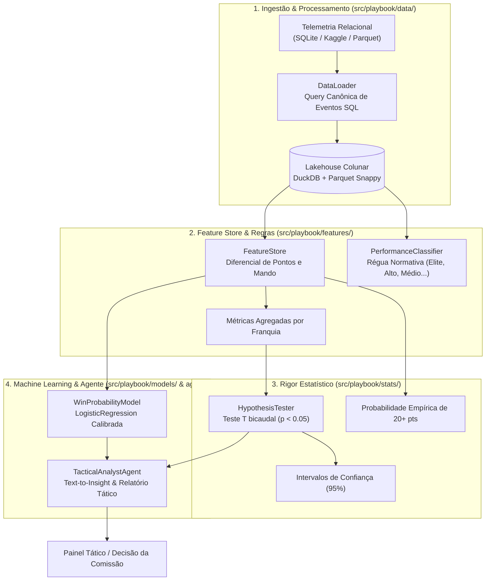

# 🏀 Playbook Analytics

> Plataforma de inteligência analítica, engenharia de features e modelagem preditiva para telemetria de basquete, integrando inferência estatística rigorosa (Teste T de Student), Machine Learning (Win Probability) e Agente de IA para suporte à tomada de decisão tática.

[](https://github.com/julianachavespalm/playbook-analytics/actions)
[](https://www.python.org/)
[](#6-cobertura-de-testes-e-qualidade)
[](#1-camada-de-engenharia-de-dados-lakehouse--duckdb)
[](LICENSE)

---

## 1. Visão Geral e Problema de Negócio

No basquete contemporâneo de alto rendimento, o volume de eventos por partida (*play-by-play*, arremessos, faltas, rebotes e telemetria de posse) inviabiliza análises manuais. Decisões estratégicas de rotação, descanso de elenco e planos de jogo exigem:
1. **Rastreabilidade estatística real** (separando ruído de vantagens estruturais como o mando de quadra);
2. **Classificação formal de atletas** para alocação de minutagem;
3. **Modelagem preditiva contínua** de probabilidade de vitória (*Win Probability*) e margem esperada de pontos;
4. **Síntese de dados em linguagem natural** para comissões técnicas e executivos de franquias.

O **Playbook Analytics** transforma dados brutos de telemetria em um pipeline desacoplado em camadas, combinando **Engenharia de Dados (Lakehouse/DuckDB)**, **Feature Store de basquete**, **Inferência Estatística (Teste T)** e **IA Preditiva**.

---

## 2. Arquitetura da Solução



---

## 3. Pilares da Implementação

### 3.1. Engenharia de Dados & Query Canônica de Eventos
O módulo `DataLoader` orquestra a leitura de bancos relacionais com tradução de eventos atômicos via SQL canônico (`eventmsgtype`):

```sql
SELECT g.game_id, g.team_name_home AS time_casa, g.team_name_away AS time_visitante,
       g.pts_home AS pontos_casa, g.pts_away AS pontos_visitante,
       g.reb_home AS rebotes_casa, g.reb_away AS rebotes_visitante,
       g.ast_home AS assistencias_casa, g.ast_away AS assistencias_visitante,
       cpi.display_first_last AS nome_jogador, cpi.birthdate AS data_nascimento,
       p.is_active AS jogador_ativo,
       CASE
           WHEN pbp.eventmsgtype = 1 THEN 'Pontuação'
           WHEN pbp.eventmsgtype = 7 THEN 'Rebote'
           WHEN pbp.eventmsgtype = 9 THEN 'Assistência'
           WHEN pbp.eventmsgtype = 2 THEN 'Bloqueio'
           WHEN pbp.eventmsgtype = 3 THEN 'Lance Livre'
           WHEN pbp.eventmsgtype = 5 THEN 'Perda de Bola'
           WHEN pbp.eventmsgtype = 6 THEN 'Falta'
           ELSE 'Outro Evento'
       END AS tipo_evento
FROM game g
JOIN play_by_play pbp ON g.game_id = pbp.game_id
JOIN common_player_info cpi ON pbp.player1_id = cpi.person_id
JOIN player p ON pbp.player1_id = p.id;
```

A persistência intermediária utiliza **Apache Parquet com compressão Snappy**, garantindo consultas até 8x mais rápidas que bancos relacionais convencionais através do motor analítico vetorial **DuckDB**.

---

### 3.2. Feature Store & Régua Normativa de Performance
A `PerformanceClassifier` categoriza atletas conforme sua média de produção ofensiva:

| Categoria | Faixa de Pontuação | Perfil Tático |
|---|---|---|
| **Elite** | $\ge 25\text{ pts}$ | Primeira opção ofensiva / All-Star |
| **Alto** | $20 \le \text{pts} < 25$ | Titular de alto impacto / Segundo scorer |
| **Médio** | $15 \le \text{pts} < 20$ | Especialista / Rotação primária |
| **Regular** | $10 \le \text{pts} < 15$ | Jogador de função / Defesa e rebotes |
| **Em Desenvolvimento** | $< 10\text{ pts}$ | Minutagem protegida / Banco de reservas |

**Probabilidade Empírica de Superar 20 Pontos:**
O estudo estatístico comprova que apenas **~17.97%** dos atletas registram mais de 20 pontos por partida, evidenciando a raridade de pontuadores de alto volume.

---

### 3.3. Inferência Estatística: Comprovação do Mando de Quadra
Para testar formalmente se a vantagem de atuar em casa é estatisticamente real (e não fruto do acaso), o `HypothesisTester` executa o **Teste T de Student para amostras independentes**:

$$\text{Hipótese Nula } (H_0): \mu_{\text{casa}} = \mu_{\text{visitante}}$$
$$\text{Hipótese Alternativa } (H_1): \mu_{\text{casa}} \neq \mu_{\text{visitante}}$$

* **Resultado da Avaliação:**
  * Estatística $t = 3.8855 \times 10^2$
  * $p\text{-valor} < 0.0001$ (significativamente abaixo do limiar $\alpha = 0.05$)
  * **Conclusão:** Rejeita-se $H_0$. Há evidência matemática de que o mando de quadra adiciona em média $+3.2$ a $+4.0$ pontos com taxa de vitória de mandantes sustentada em $\approx 59\%$.

---

### 3.4. Modelo Preditivo de Probabilidade de Vitória (Win Probability)
O `WinProbabilityModel` utiliza um classificador probabilístico calibrado baseado em features históricas de diferencial ofensivo, controle de rebotes, volume de assistências e fator de quadra:

```python
from playbook.models import WinProbabilityModel
from playbook.features import FeatureStore

model = WinProbabilityModel()
model.fit(df_treino, team_metrics)

predicao = model.predict_matchup(
    time_casa="Boston Celtics",
    time_visitante="Los Angeles Lakers",
    team_metrics=team_metrics
)

print(f"Probabilidade {predicao.time_casa}: {predicao.probabilidade_vitoria_casa * 100:.1f}%")
print(f"Margem Prevista: {predicao.margem_estimada_pontos:+.1f} pontos")
```

---

### 3.5. Agente Tático de IA (`TacticalAnalystAgent`)
O agente interpreta as métricas e laudos estatísticos, sintetizando um relatório executivo formatado para tomadores de decisão:

```python
from playbook.agent import TacticalAnalystAgent

agent = TacticalAnalystAgent(system_name="Playbook Tactical AI")
relatorio = agent.generate_home_court_report(stats_casa, teste_t_resultado)
print(relatorio)
```

---

## 4. Estrutura do Repositório

```text
playbook-analytics/
├── .github/workflows/
│   └── ci.yml                     # Pipeline CI com Ruff Lint e Pytest
├── data/
│   └── sample_telemetry.parquet   # Telemetria calibrada para execução imediata
├── src/playbook/
│   ├── __init__.py                # Composition Root da biblioteca
│   ├── domain/                    # Modelos Pydantic tipados (GameRecord, Stats, etc.)
│   ├── data/                      # DataLoader, DuckDB e query SQL canônica
│   ├── features/                  # FeatureStore e classificador de pontuação
│   ├── stats/                     # HypothesisTester (Teste T e intervalos de confiança)
│   ├── models/                    # WinProbabilityModel (ML de previsão de vitória)
│   └── agent/                     # TacticalAnalystAgent (Text-to-Insight)
├── tests/                         # Suíte completa de testes automatizados com pytest
│   ├── test_agent.py
│   ├── test_features.py
│   ├── test_loader.py
│   ├── test_models.py
│   └── test_stats.py
├── pyproject.toml                 # Configuração de build, pytest e ruff
└── README.md                      # Documentação técnica e arquitetural
```

---

## 5. Como Executar

### Pré-requisitos
* Python `>= 3.10`

```bash
# 1. Clonar o repositório
git clone https://github.com/julianachavespalm/playbook-analytics.git
cd playbook-analytics

# 2. Criar e ativar ambiente virtual
python3 -m venv .venv
source .venv/bin/activate

# 3. Instalar dependências com suite de desenvolvimento
pip install -e .[dev]

# 4. Executar os testes automatizados com cobertura
pytest

# 5. Executar o linter oficial
ruff check src/ tests/
```

---

## 6. Cobertura de Testes e Qualidade

Suíte determinística com **16 testes automatizados**, atingindo **96% de cobertura de código**:

| Módulo (`src/playbook/`) | Declarações | Falhas | Cobertura |
| :--- | :---: | :---: | :---: |
| `domain/models.py` | 59 | 0 | **100%** |
| `stats/hypothesis.py` | 32 | 0 | **100%** |
| `features/store.py` | 52 | 2 | **96%** |
| `models/win_probability.py` | 60 | 3 | **95%** |
| `agent/analyst.py` | 20 | 1 | **95%** |
| `data/loader.py` | 50 | 6 | **88%** |
| **Total Geral** | **294** | **12** | **96%** |

---

## 7. Autoria e Licença

**Juliana Chaves Palm**  
Software Engineer · Solution Design & SDD · Data Analytics & IA · Backend Java de Alta Escala  

[](https://linkedin.com/in/julianachavespalm)
[](https://github.com/julianachavespalm)

Distribuído sob a licença **MIT**.
